

  <picture>
    <source media="(prefers-color-scheme: dark)" srcset="docs/readme/banner-en-dark.png">
    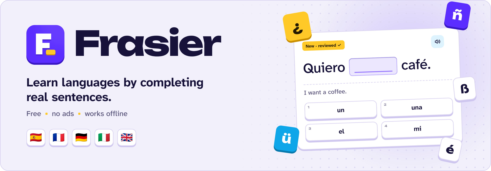
  </picture>

<b>🇬🇧 English</b> · <a href="README.pt-BR.md">🇧🇷 Português</a>

  <a href="https://lucas-ayub.github.io/frasier-language-app/"><b>▶ Open the app</b></a>
  &nbsp;·&nbsp; <a href="#-where-it-runs-and-how-to-install">Where it runs</a>
  &nbsp;·&nbsp; <a href="#-courses">Courses</a>
  &nbsp;·&nbsp; <a href="#-tracks">Tracks</a>
  &nbsp;·&nbsp; <a href="#-visual-identity">Visual identity</a>
  &nbsp;·&nbsp; <a href="#-under-the-hood">Under the hood</a>

  
  
  
  

  
  
  

**Frasier** is a free, Clozemaster-style language app. You learn a language by **completing real sentences**: one word is hidden, you see the translation in your own language, and you choose, type or say the missing word. Spaced repetition brings each sentence back at the right time until it sticks.

> **Runs on any device, right in the browser — nothing to download from an app store.** iPhone and iPad, Android phones and tablets, and desktop (Windows, Mac, Linux, Chromebook). Just open **[lucas-ayub.github.io/frasier-language-app](https://lucas-ayub.github.io/frasier-language-app/)**. You can also install it as an app on your home screen or desktop ([see how](#-where-it-runs-and-how-to-install)). With an account, your progress is the same on your phone and your computer.

> **About the language of the app:** the interface is in **Brazilian Portuguese**. Courses exist for Portuguese speakers (→ Spanish, French, German, Italian, English) and for English speakers (→ German, Spanish, French, Italian), so the sentence translations are in English when you learn from English.

  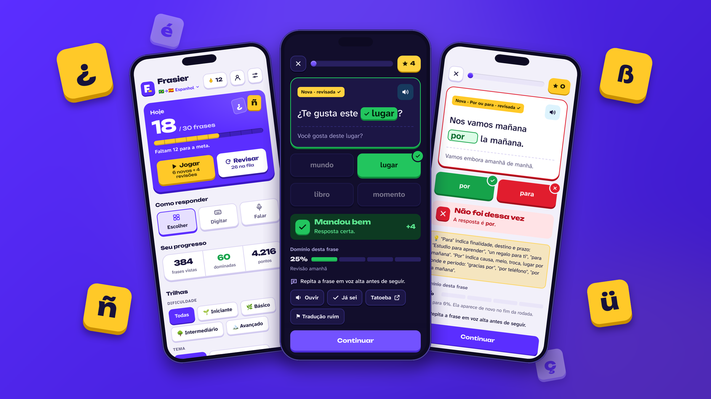

## 🎬 See it in action

<table>
  <tr>
    <td align="center" width="33%">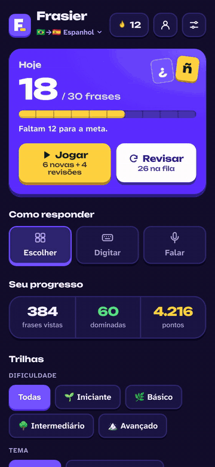 <b>A round</b> — choose, miss, learn</td>
    <td align="center" width="33%"> <b>Typing</b> — green or red, letter by letter</td>
    <td align="center" width="33%">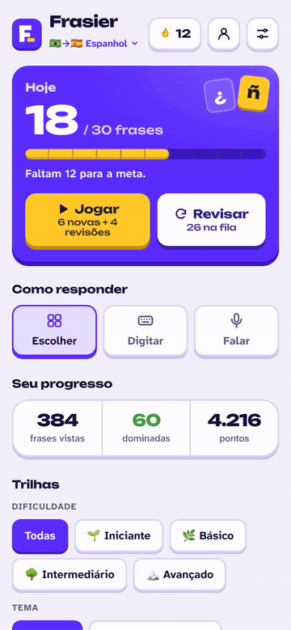 <b>Tracks</b> — difficulty and topic</td>
  </tr>
</table>

Video versions (MP4): <a href="docs/readme/demo-round.mp4">round</a> · <a href="docs/readme/demo-typing.mp4">typing</a> · <a href="docs/readme/demo-tracks.mp4">tracks</a>

## ✨ Features

<picture>
  <source media="(prefers-color-scheme: dark)" srcset="docs/readme/features-en-dark.png">
  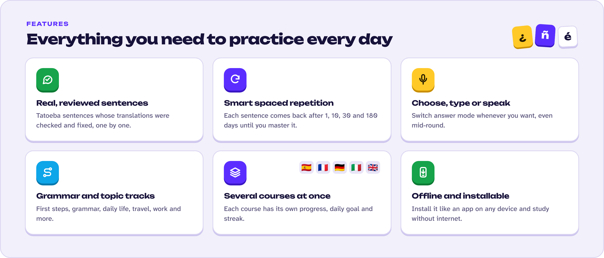
</picture>

- **Three ways to answer, switch any time** (even mid-round):
  - **Choose** — 4 options;
  - **Type** — every letter turns **green or red as you type** (accents count), **Hint** reveals one letter at a time, and the language's accent keys (ñ, ç, ß, ü…) are right there; press Enter to check;
  - **Speak** — say the sentence and the app recognizes the word.
- **Audio** for every sentence, with adjustable accent and speed.
- **Daily goal**, 🔥 **streak**, points and a summary at the end of each round.
- **Several courses at once**, Duolingo-style (e.g. Portuguese → Spanish and English → German), each with its own progress, goal and streak.
- **Optional account** (email and password) to sync progress across devices; without an account everything is saved on the device. Copy-paste backup.
- **Light and dark theme**, following your system.

## 📱 Where it runs and how to install

Frasier is a **web app (PWA)**: it runs in any modern browser. Using it in the browser already works; installing is optional and just gives it its own icon and full screen.

| Device | Browser | Use | Install as an app (optional) |
|---|---|---|---|
| 📱 **iPhone / iPad** | Safari (or Chrome, Edge…) | ✅ | Safari › **Share** button (or **⋯ › Share**) › **Add to Home Screen** |
| 🤖 **Android** (phone and tablet) | Chrome, Edge, Samsung Internet, Firefox… | ✅ | Chrome › **⋮** › **Install app** (or **Add to Home screen**) |
| 💻 **Desktop** (Windows, Mac, Linux, Chromebook) | Chrome, Edge, Safari, Firefox… | ✅ | Chrome/Edge › **Install** icon in the address bar (or **⋮ › Cast, save and share › Install page as app**). Safari on Mac: **File › Add to Dock** |

- **On a computer** you can play with the keyboard only: **1–4** pick an option, type your answer and press **Enter**.
- **Works offline** after the first visit: the sentences you play are cached, and **Ajustes › Baixar todas as frases** (Settings › Download all sentences) saves the whole course.
- **Same progress everywhere:** create an account (email and password) and sign in on your phone and computer. Without an account, progress stays on the device you used.
- **Speak mode** uses the browser's speech recognition: it works in Chrome, Edge and Safari. In Firefox, use Choose and Type.
- **Updating:** reload the page or use **Ajustes › Procurar atualização** (Settings › Check for update).

## 🌍 Courses

All sentences come from [Tatoeba](https://tatoeba.org), and only **direct, human-made translations** are used, prioritizing native speakers and sentences with audio. On top of that, every sentence went (or is going) through a **full translation review**: the translation is fixed or the sentence is removed from the app.

| Course | Sentences | Translation review |
|---|---:|---|
| 🇧🇷 → 🇪🇸 Portuguese → Spanish | 62,973 | ✅ 100% — 6,580 fixed, 2,234 removed |
| 🇧🇷 → 🇫🇷 Portuguese → French | 24,858 | ✅ 100% — 3,372 fixed, 853 removed |
| 🇧🇷 → 🇩🇪 Portuguese → German | 17,047 | ✅ 100% — 2,249 fixed, 730 removed |
| 🇧🇷 → 🇮🇹 Portuguese → Italian | 9,176 | ✅ 100% — 1,125 fixed, 321 removed |
| 🇬🇧 → 🇩🇪 English → German | 120,000 | ✅ 100% — 5,900 fixed, 3,429 removed |
| 🇧🇷 → 🇬🇧 Portuguese → English | 120,000 | ⏳ 45,000 reviewed so far (3,983 fixed) |
| 🇬🇧 → 🇪🇸 🇫🇷 🇮🇹 English → Spanish, French, Italian | 120,000 each | coming soon |

Reviewed sentences carry a **“revisada ✓”** (reviewed) badge. Found an odd translation? The **⚑ Tradução ruim** (bad translation) button removes the sentence from your studies.

## 🧠 How it teaches

- **Mastery from 0 to 100%** per sentence. Each correct answer moves it up a level and the sentence comes back after **1, 10, 30 and 180 days**; a mistake resets it to 0%.
- **Balanced rounds:** **Jogar** (Play) mixes 3–5 due reviews among new sentences (more when the backlog grows), and at least half of every round is new. You keep learning new things without the review queue getting out of hand.
- **Missed it? It comes back at the end of the round** (up to twice). Get it right on the retry and it comes back **tomorrow** to make sure it stuck.
- **No instant repeats:** a sentence seen in the last 10 minutes won't show up as a review.
- **“Já sei”** (I know this) marks an easy sentence as mastered; **Revisar** (Review) plays only your review queue.

## 🧭 Tracks

<table>
  <tr>
    <td width="33%">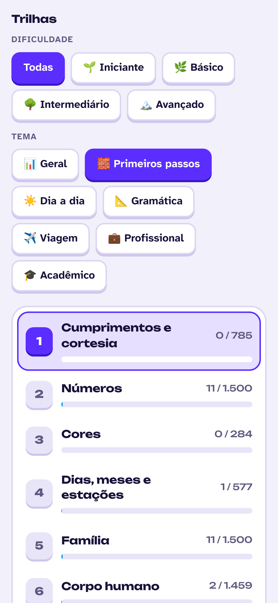</td>
    <td width="33%">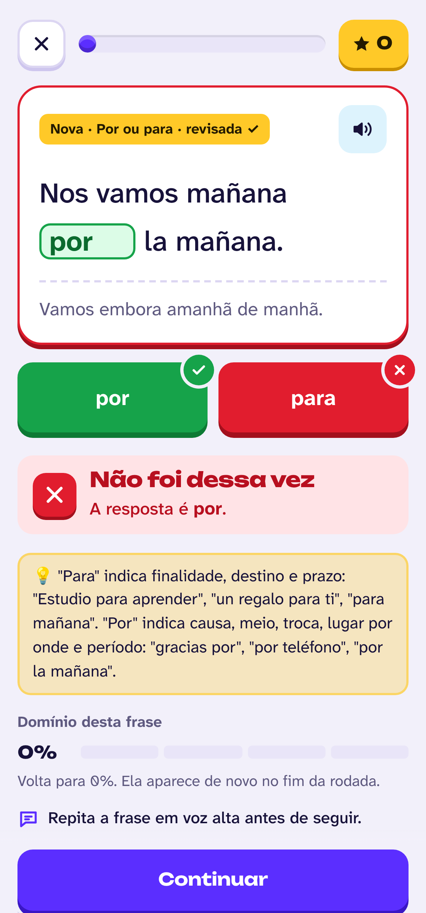</td>
    <td width="33%">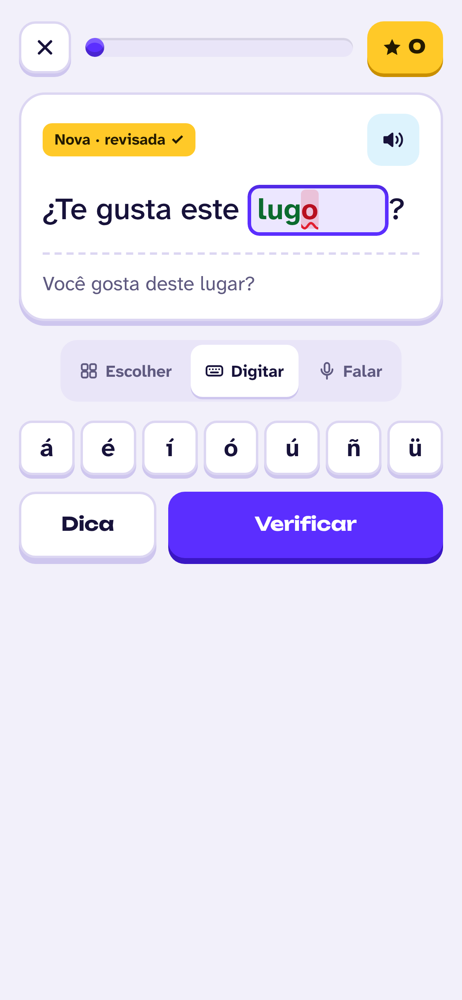</td>
  </tr>
</table>

- **🎚️ Difficulty** for any track: All · 🌱 Beginner · 🌿 Basic · 🌳 Intermediate · 🏔️ Advanced (based on how frequent the rarest word in the sentence is).
- **📊 General:** collections Top 100, 500, 1,000, 2,000, 5,000, 10,000 and Advanced; the hidden word is the rarest word of the sentence.
- **🧱 First steps** (13 topics): greetings, numbers, colors, days and months, family, body, clothes, animals, food, question words, places, jobs and opposite adjectives. The hidden word **is** the topic word, and the options come from the same set (other colors, other numbers…).
- **📐 Grammar** (12 topics per language, designed by specialist agents for teaching each language). The hidden word is the grammar point itself, and each topic has a **tip** that shows up when you get it wrong:

  | Language | Topics |
  |---|---|
  | 🇪🇸 Spanish | articles, al/del, **ser vs estar**, hay vs está, muy vs mucho, possessives, demonstratives, gusta/gustan, **por vs para**, reflexives, preterite (fue/era), subjunctive |
  | 🇫🇷 French | articles, être/avoir, negation, possessives, demonstratives, à/en/au + places, partitive, passé composé auxiliary, imparfait, le/lui/leur, y/en, qui/que |
  | 🇩🇪 German | sein/haben, ein/eine, nicht/kein, possessives, modal verbs, preposition + case, in/an/auf (dative/accusative), mich/mir, Perfekt with haben or sein, weil/dass/wenn/ob, relative pronouns, adjective endings |
  | 🇮🇹 Italian | articles (il/lo…), indefinite article, essere/avere, possessives, preposition + article, a/in, molto/troppo, reflexives, passato prossimo auxiliary, future, pronouns |
  | 🇬🇧 English | a/an/the, to be, there is/are, present -s, do/does/did, his/her, in/on/at, some/any, irregular past, past participle, comparatives, make/do |

- **☀️ Daily life** (grocery, restaurant, transport, home, health, weather, routine, leisure, feelings), **✈️ Travel** (airport, hotel, directions, sightseeing), **💼 Work** (office, email and phone, career, business, tech) and **🎓 Academic** (school, science, history, nature, art).

## 🖼️ Screens

<table>
  <tr>
    <td width="25%">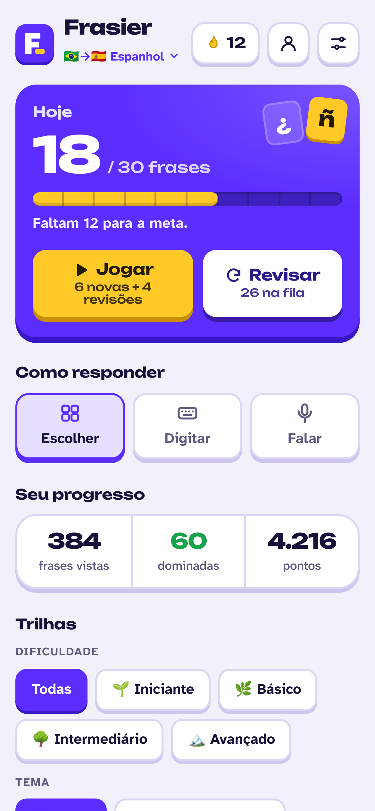</td>
    <td width="25%">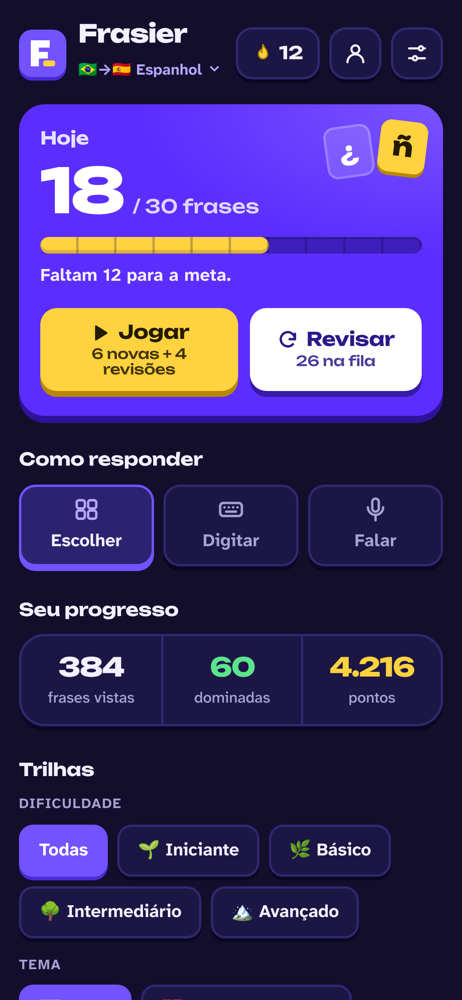</td>
    <td width="25%">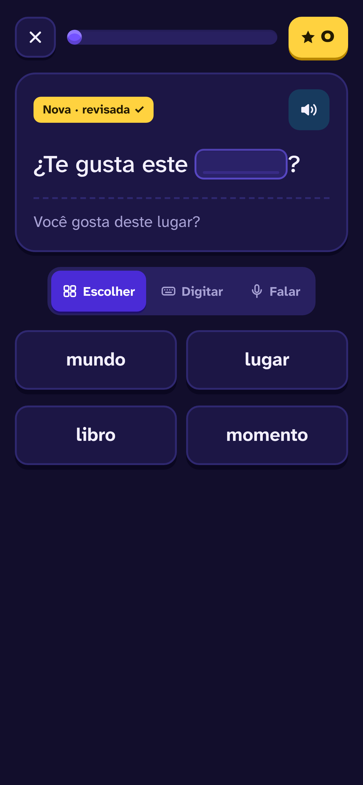</td>
    <td width="25%">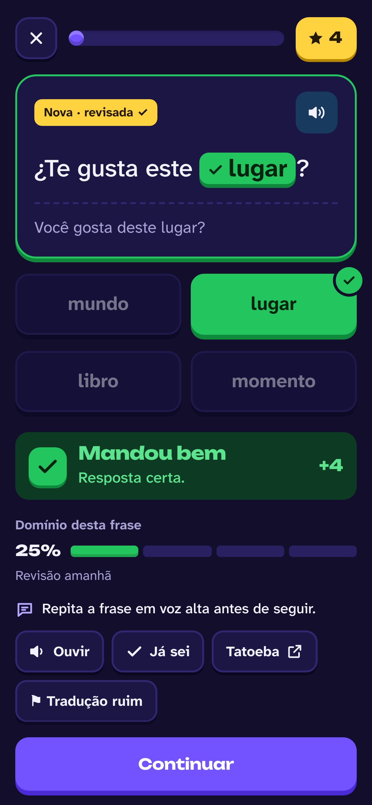</td>
  </tr>
  <tr>
    <td align="center">Home (light)</td>
    <td align="center">Home (dark)</td>
    <td align="center">Multiple choice</td>
    <td align="center">Correct answer and mastery</td>
  </tr>
  <tr>
    <td width="25%">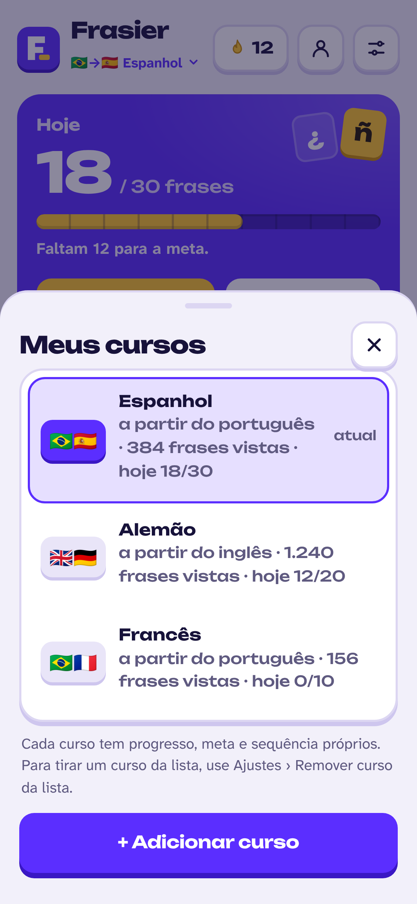</td>
    <td width="25%">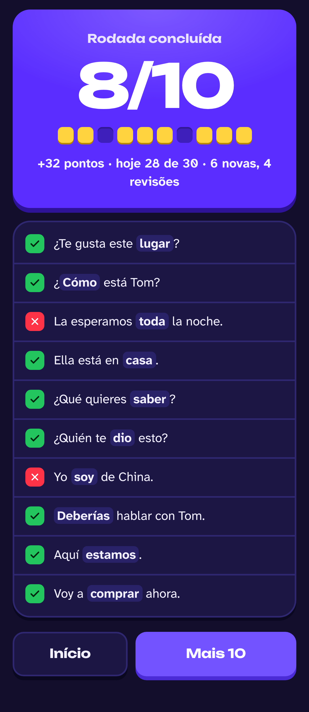</td>
    <td width="25%"></td>
    <td width="25%"></td>
  </tr>
  <tr>
    <td align="center">My courses</td>
    <td align="center">Round summary</td>
    <td align="center">Tracks</td>
    <td align="center">Typing</td>
  </tr>
</table>

## 🎨 Visual identity

The look is called **“Arcade of sentences”** (*Fliperama de frases*): chunky buttons with a solid shadow like arcade keys, letter tiles (¿ ñ ß ü) as decoration, rounded corners and a small “pop” animation on every answer. Violet gives it personality, yellow calls to action, and green and red only ever mean right and wrong.

<picture>
  <source media="(prefers-color-scheme: dark)" srcset="docs/readme/palette-en-dark.png">
  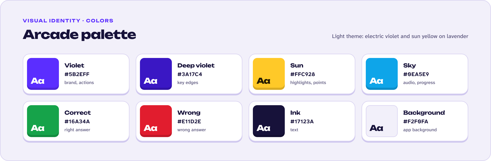
</picture>

<picture>
  <source media="(prefers-color-scheme: dark)" srcset="docs/readme/type-en-dark.png">
  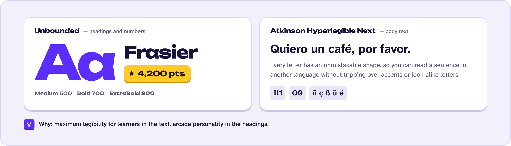
</picture>

<picture>
  <source media="(prefers-color-scheme: dark)" srcset="docs/readme/components-en-dark.png">
  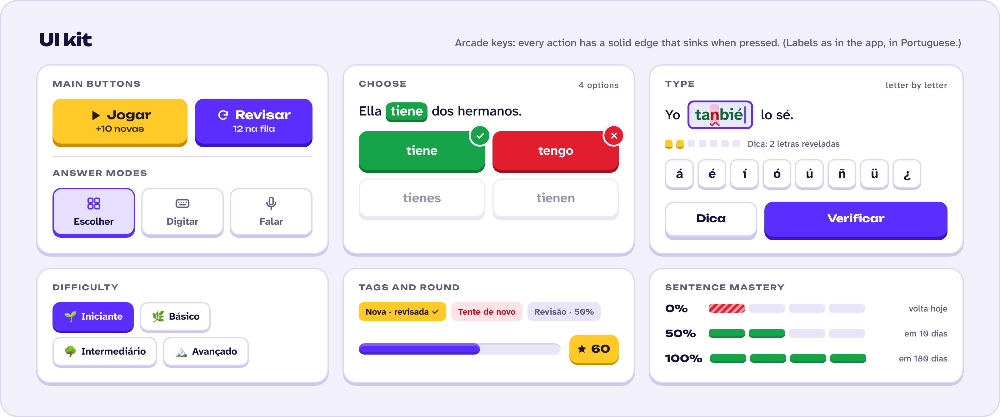
</picture>

## 🛠️ Under the hood

- **A single file:** `index.html` with HTML, CSS and plain JavaScript — no framework and no build step. `sw.js` is the service worker (offline and updates) and `manifest.webmanifest` makes the app installable.
- **Data** in `data/<source>-<target>/`: chunks `c0.json`, `c1.json`… with 2,000 sentences each (`[sentence, translation, cloze start, cloze length, Tatoeba id, Tatoeba id]`), `index.json` (levels, hidden sentences, how far the review got), `words.json`, `tracks.json` (topic tracks) and `tracks2.json` (First steps and Grammar, with the cloze position and the options for each sentence).
- **Sentence pipeline** in `tools/`:
  - `build_courses.py` — downloads the Tatoeba exports, scores quality (native speaker, audio, community tags and negative reviews, length ratio), orders by word frequency and builds the courses. Runs in a GitHub Actions workflow triggered by `tools/rebuild.txt`.
  - `apply_reviews.py` — applies the reviews in `tools/reviews/<pair>.json` (fixed translations and removed sentences, keyed by Tatoeba id).
  - `build_tracks.py` — builds the tracks from the rules in `tools/tracks/<language>.json` (one regex per topic with the word to hide and the options).
- **Accounts and sync:** Firebase Authentication (email and password) and Firestore, with rules that only let each user read and write their own data.

**Run locally:** serve the folder with any static server, e.g. `python3 -m http.server`, and open `http://localhost:8000`.

## 🙏 Credits

- Sentences and translations: [Tatoeba.org](https://tatoeba.org), licensed [CC BY 2.0 FR](https://creativecommons.org/licenses/by/2.0/fr/). Every sentence links back to the original.
- Fonts: [Unbounded](https://fonts.google.com/specimen/Unbounded) and [Atkinson Hyperlegible Next](https://fonts.google.com/specimen/Atkinson+Hyperlegible+Next) (SIL Open Font License).
- Inspired by [Clozemaster](https://www.clozemaster.com).
- Made by **Lucas Ayub**, with help from Claude (Anthropic).
