

  <picture>
    <source media="(prefers-color-scheme: dark)" srcset="docs/readme/banner-dark.png">
    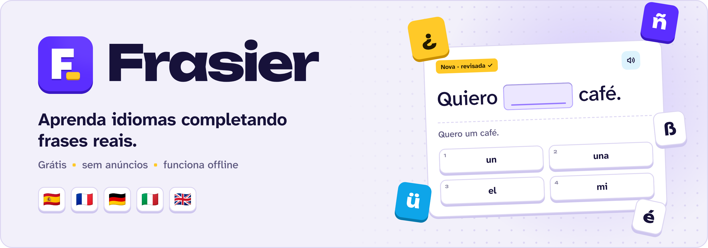
  </picture>

<a href="README.md">🇬🇧 English</a> · <b>🇧🇷 Português</b>

  <a href="https://lucas-ayub.github.io/frasier-language-app/"><b>▶ Abrir o app</b></a>
  &nbsp;·&nbsp; <a href="#-onde-funciona-e-como-instalar">Onde funciona</a>
  &nbsp;·&nbsp; <a href="#-estudo-completo-do-dia-novo-na-30">Estudo do dia</a>
  &nbsp;·&nbsp; <a href="#-cursos">Cursos</a>
  &nbsp;·&nbsp; <a href="#-trilhas">Trilhas</a>
  &nbsp;·&nbsp; <a href="#-identidade-visual">Identidade visual</a>
  &nbsp;·&nbsp; <a href="#-como-funciona-por-dentro">Por dentro</a>

  
  
  
  

  
  
  

O **Frasier** é um app gratuito no estilo do Clozemaster. Você aprende um idioma **completando frases reais**: uma palavra some, você vê a tradução no seu idioma e escolhe, digita ou fala a palavra que falta. A revisão espaçada traz cada frase de volta na hora certa até ela ficar gravada.

> **Funciona em qualquer aparelho, direto no navegador — sem baixar nada da loja.** iPhone e iPad, celulares e tablets Android, e computador (Windows, Mac, Linux, Chromebook). É só abrir **[lucas-ayub.github.io/frasier-language-app](https://lucas-ayub.github.io/frasier-language-app/)**. Se quiser, dá para instalar como app na tela de início ou na área de trabalho ([veja como](#-onde-funciona-e-como-instalar)). Com uma conta, o progresso é o mesmo no celular e no computador.

  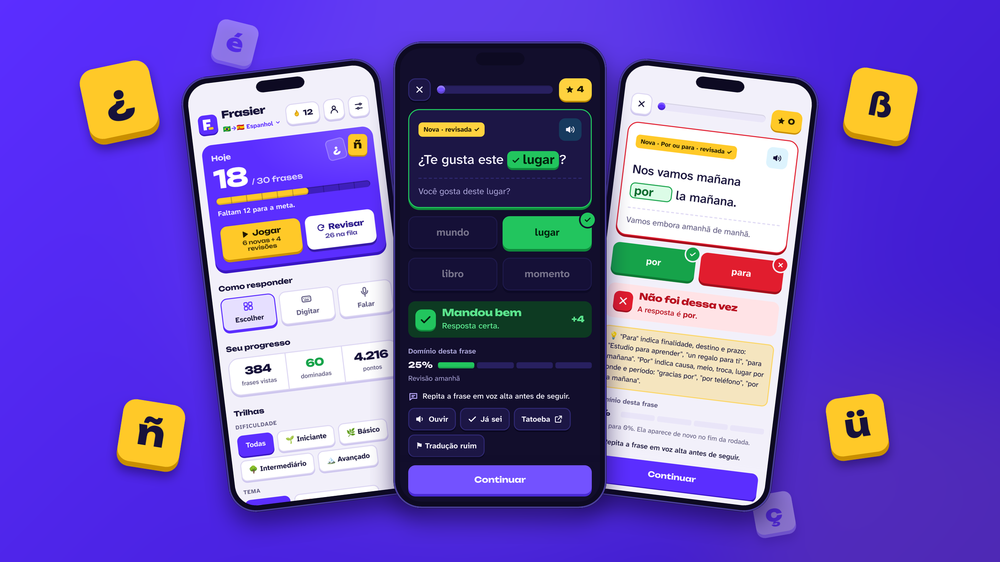

## 🎬 O app em ação

<table>
  <tr>
    <td align="center" width="33%">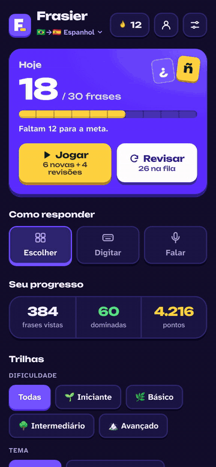 <b>Uma rodada</b> — escolher, errar, aprender</td>
    <td align="center" width="33%"> <b>Digitar</b> — letra verde ou vermelha na hora</td>
    <td align="center" width="33%">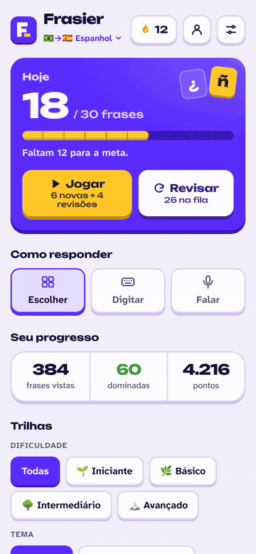 <b>Trilhas</b> — dificuldade e tema</td>
  </tr>
</table>

Versões em vídeo (MP4): <a href="docs/readme/demo-round.mp4">rodada</a> · <a href="docs/readme/demo-typing.mp4">digitação</a> · <a href="docs/readme/demo-tracks.mp4">trilhas</a>

## 🎓 Estudo completo do dia (novo na 3.0)

Além do jogo de lacunas, o Frasier agora tem uma **rotina completa de 30–40 min por dia** — como ter um tutor:

<table>
  <tr>
    <td width="25%">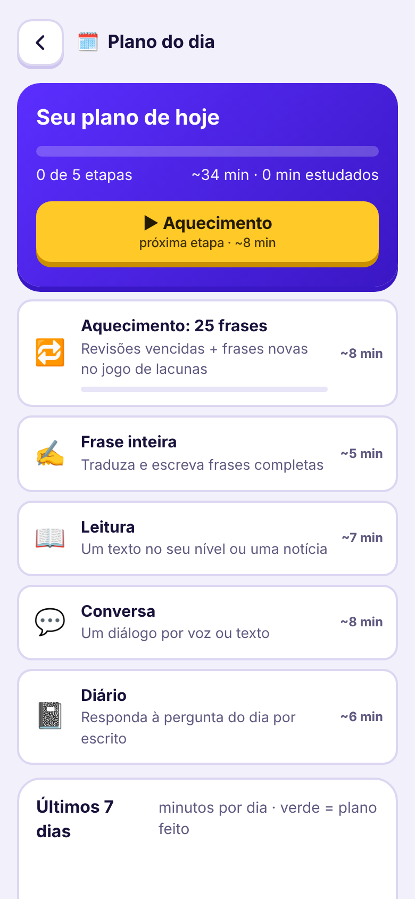</td>
    <td width="25%">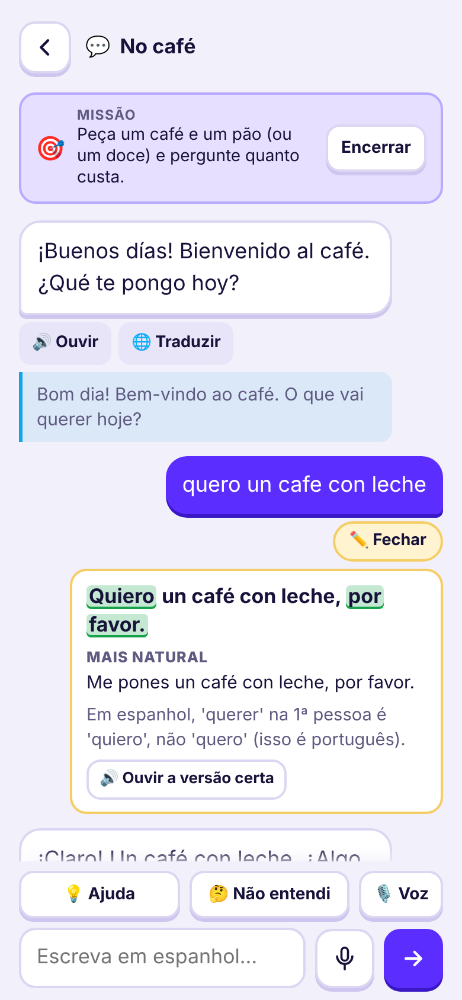</td>
    <td width="25%">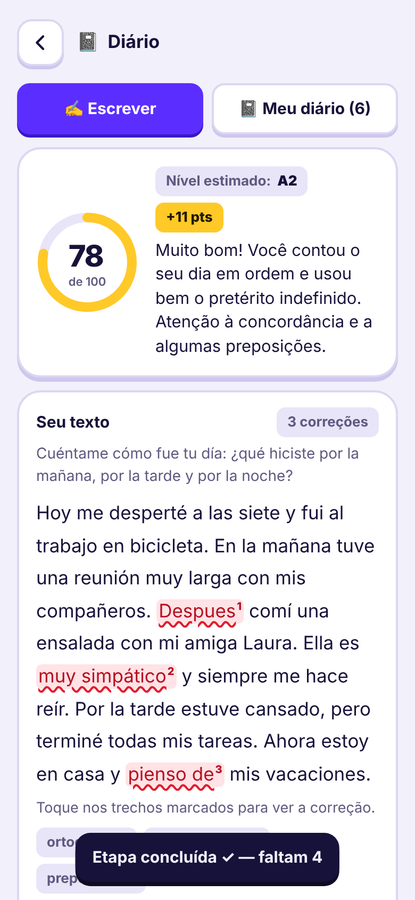</td>
    <td width="25%">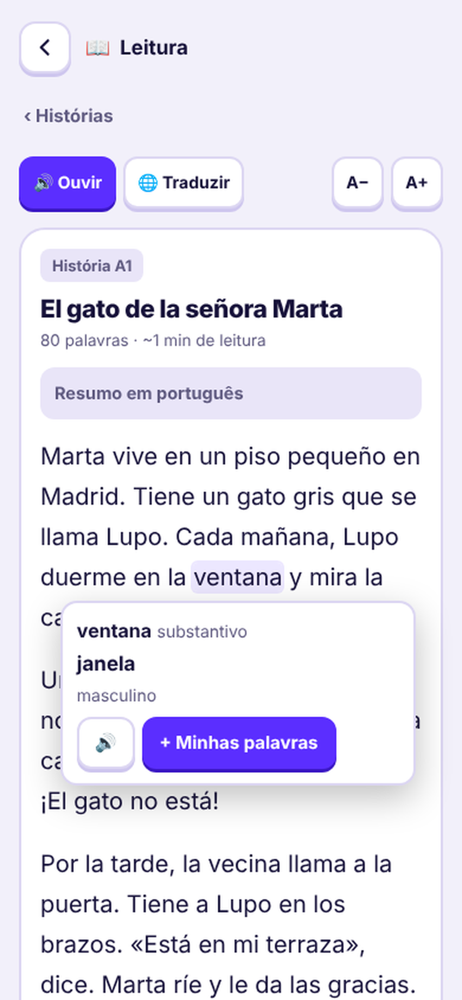</td>
  </tr>
  <tr>
    <td align="center">🗓️ Plano do dia</td>
    <td align="center">💬 Conversa</td>
    <td align="center">📓 Diário</td>
    <td align="center">📖 Leitura</td>
  </tr>
  <tr>
    <td width="25%">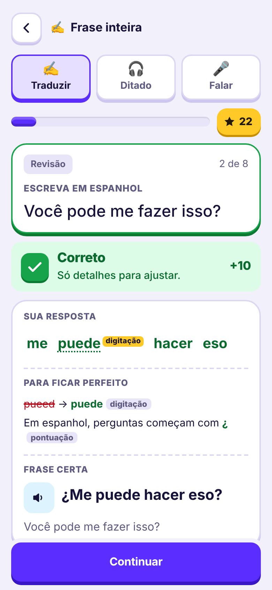</td>
    <td width="25%">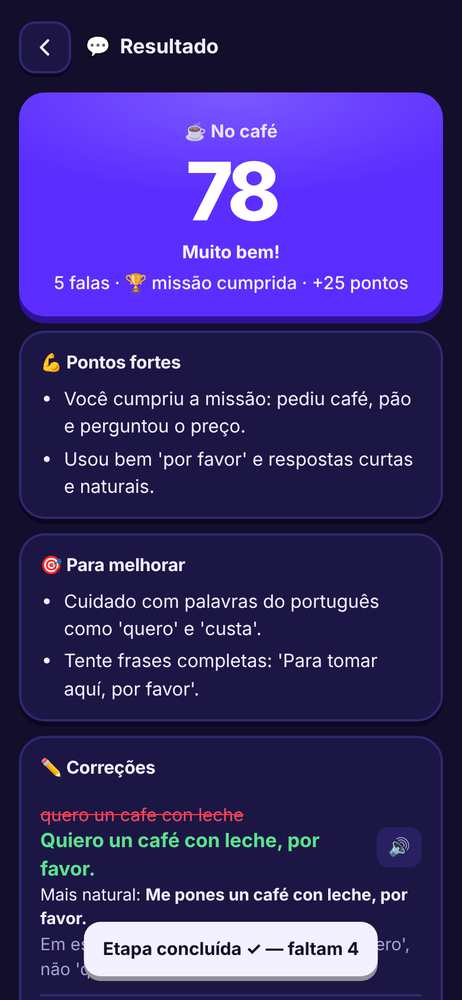</td>
    <td width="25%">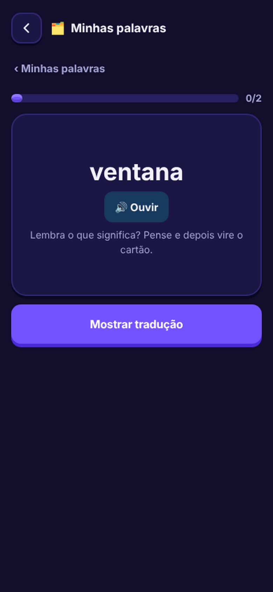</td>
    <td></td>
  </tr>
  <tr>
    <td align="center">✍️ Frase inteira</td>
    <td align="center">Avaliação da conversa</td>
    <td align="center">🗂️ Minhas palavras</td>
    <td></td>
  </tr>
</table>

- **🗓️ Plano do dia** — sessão guiada: aquecimento de frases → frase inteira → leitura → conversa → diário (e as palavras salvas, quando houver revisão). Escolha seu **nível (A1–C1)** e o tamanho (**Leve ~20 min · Completo ~35 · Intenso ~50**); um gráfico mostra seus minutos na semana.
- **✍️ Frase inteira** — escreva a frase **toda**: *Traduzir*, *Ditado* (ouvir e escrever) ou *Falar*. A correção é **tolerante, como no Duolingo**: digitação, acento, pontuação e maiúscula são apontados mas não reprovam, e a IA aceita **outras traduções corretas**. Erros palavra por palavra; as erradas voltam no fim da rodada.
- **💬 Conversa** — 17 situações (café, médico, hotel, entrevista de emprego, papo livre, “o tutor pergunta sobre você”…), cada uma com uma missão. **Modo voz mãos-livres**: o bot fala, o microfone abre e você responde. Correções gentis em cada mensagem, 💡 sugestões, “Não entendi”, esconder o texto do bot para treinar o ouvido e uma avaliação final (nota, pontos fortes, erros, vocabulário).
- **📓 Diário** — uma pergunta por dia no seu nível (“como foi seu dia?”, planos, opiniões…). Escreva ou dite e receba nota, cada erro marcado e explicado, o texto corrigido, **como um nativo diria**, vocabulário e uma pergunta para continuar. Histórico com gráfico da evolução.
- **📖 Leitura** — **histórias escritas no seu nível** com perguntas de compreensão, **manchetes reais de hoje** e **artigos da Wikipédia** no idioma (com “adaptar ao meu nível”). Toque em qualquer palavra para ver a tradução no contexto, ouça parágrafo por parágrafo, traduza um parágrafo.
- **🗂️ Minhas palavras** — toda palavra que você salva (tocando nela em qualquer lugar) vai para um baralho com revisão espaçada, cartões e modo de escrever.

**IA:** **Gemini** do Google pelo Firebase AI Logic (plano gratuito), protegido por **App Check + reCAPTCHA** para que só o Frasier use a cota do projeto. As atividades com IA precisam de internet; o jogo de frases continua funcionando offline. A voz usa o reconhecimento e as vozes do próprio navegador (funciona no Safari do iPhone, Chrome e Edge; não no Firefox).

## ✨ Recursos

<picture>
  <source media="(prefers-color-scheme: dark)" srcset="docs/readme/features-dark.png">
  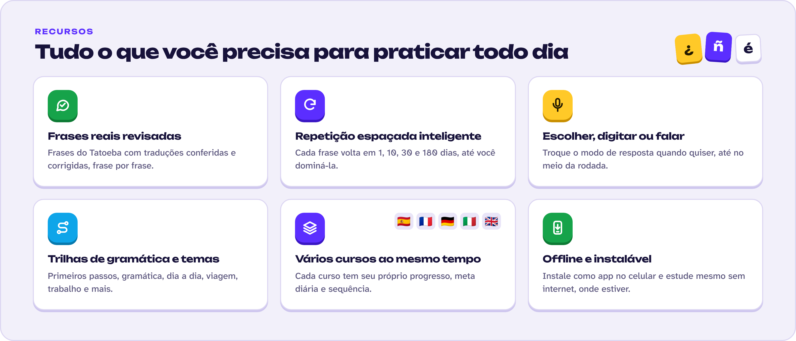
</picture>

- **Três jeitos de responder, trocando quando quiser** (até no meio da rodada):
  - **Escolher** — 4 alternativas;
  - **Digitar** — cada letra fica **verde ou vermelha enquanto você digita** (acento conta), **Dica** revela letra por letra e as teclas de acento do idioma (ñ, ç, ß, ü…) ficam à mão; confirme com Enter;
  - **Falar** — diga a frase e o app reconhece a palavra.
- **Áudio** de todas as frases, com sotaque e velocidade ajustáveis.
- **Meta diária**, 🔥 **sequência de dias**, pontos e resumo no fim de cada rodada.
- **Vários cursos ao mesmo tempo**, como no Duolingo (por exemplo, português → espanhol e inglês → alemão), cada um com progresso, meta e sequência próprios.
- **Conta opcional** (e-mail e senha) que sincroniza o progresso entre aparelhos; sem conta, tudo fica salvo no próprio aparelho. Backup por copiar e colar.
- **Tema claro e escuro**, seguindo o sistema.

## 📱 Onde funciona e como instalar

O Frasier é um **app web (PWA)**: roda em qualquer navegador moderno. Usar direto no navegador já funciona; instalar é opcional e só deixa o app com ícone próprio, em tela cheia.

| Aparelho | Navegador | Usar | Instalar como app (opcional) |
|---|---|---|---|
| 📱 **iPhone / iPad** | Safari (ou Chrome, Edge…) | ✅ | Safari › botão **Compartilhar** (ou **⋯ › Compartilhar**) › **Adicionar à Tela de Início** |
| 🤖 **Android** (celular e tablet) | Chrome, Edge, Samsung Internet, Firefox… | ✅ | Chrome › **⋮** › **Instalar app** (ou **Adicionar à tela inicial**) |
| 💻 **Computador** (Windows, Mac, Linux, Chromebook) | Chrome, Edge, Safari, Firefox… | ✅ | Chrome/Edge › ícone **Instalar** na barra de endereço (ou **⋮ › Transmitir, salvar e compartilhar › Instalar página como app**). No Mac com Safari: **Arquivo › Adicionar ao Dock** |

- **No computador** dá para responder só pelo teclado: **1–4** escolhem a alternativa, você digita a resposta e confirma com **Enter**.
- **Funciona offline** depois da primeira visita: as frases que você joga ficam salvas, e em **Ajustes › Baixar todas as frases** dá para levar o curso inteiro.
- **Mesmo progresso em todos os aparelhos:** crie uma conta (e-mail e senha) e entre com ela no celular e no computador. Sem conta, o progresso fica só no aparelho em que você estudou.
- **Modo Falar** usa o reconhecimento de voz do navegador: funciona no Chrome, Edge e Safari. No Firefox, use os modos Escolher e Digitar.
- **Atualizar:** recarregue a página ou use **Ajustes › Procurar atualização**.

## 🌍 Cursos

Todas as frases vêm do [Tatoeba](https://tatoeba.org) e só entram **traduções diretas, feitas por pessoas**, priorizando falantes nativos e frases com áudio. Depois disso, cada frase passou (ou está passando) por uma **revisão completa da tradução**: a tradução é corrigida ou a frase sai do app.

| Curso | Frases | Revisão das traduções |
|---|---:|---|
| 🇧🇷 → 🇪🇸 Português → Espanhol | 62.973 | ✅ 100% — 6.580 corrigidas, 2.234 removidas |
| 🇧🇷 → 🇫🇷 Português → Francês | 24.858 | ✅ 100% — 3.372 corrigidas, 853 removidas |
| 🇧🇷 → 🇩🇪 Português → Alemão | 17.047 | ✅ 100% — 2.249 corrigidas, 730 removidas |
| 🇧🇷 → 🇮🇹 Português → Italiano | 9.176 | ✅ 100% — 1.125 corrigidas, 321 removidas |
| 🇬🇧 → 🇩🇪 Inglês → Alemão | 120.000 | ✅ 100% — 5.900 corrigidas, 3.429 removidas |
| 🇧🇷 → 🇬🇧 Português → Inglês | 120.000 | ⏳ 45.000 revisadas até agora (3.983 corrigidas) |
| 🇬🇧 → 🇪🇸 🇫🇷 🇮🇹 Inglês → Espanhol, Francês, Italiano | 120.000 cada | em breve |

Frases revisadas aparecem com o selo **“revisada ✓”**. Achou uma tradução estranha? O botão **⚑ Tradução ruim** tira a frase dos seus estudos.

## 🧠 Como o app ensina

- **Domínio de 0 a 100%** por frase. Cada acerto sobe um nível e a frase volta em **1, 10, 30 e 180 dias**; um erro zera o domínio.
- **Rodadas equilibradas:** o **Jogar** mistura de 3 a 5 revisões vencidas no meio das frases novas (mais quando a fila cresce), e pelo menos metade da rodada é sempre de frases novas. Assim você aprende coisa nova sem a fila de revisão sair do controle.
- **Errou? Ela volta no fim da rodada** (até duas vezes). Se você acertar na repetição, ela volta **amanhã** para confirmar que fixou.
- **Nada de repetição imediata:** uma frase vista nos últimos 10 minutos não entra como revisão.
- **“Já sei”** marca uma frase fácil como dominada; o **Revisar** traz só a fila de revisão.

## 🧭 Trilhas

<table>
  <tr>
    <td width="33%">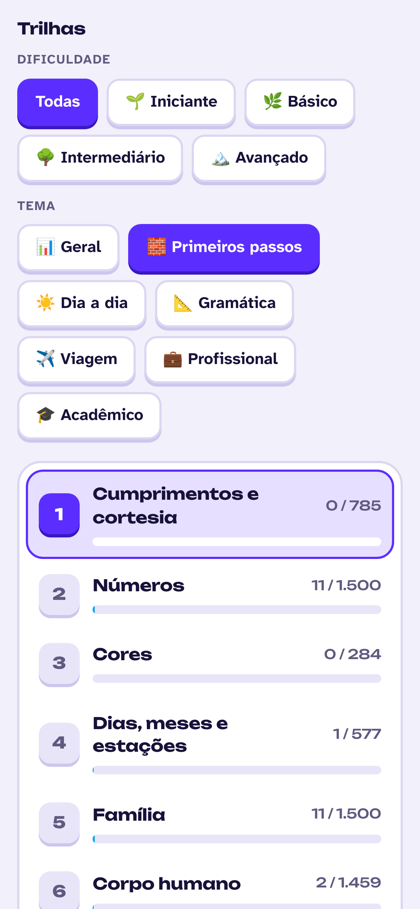</td>
    <td width="33%">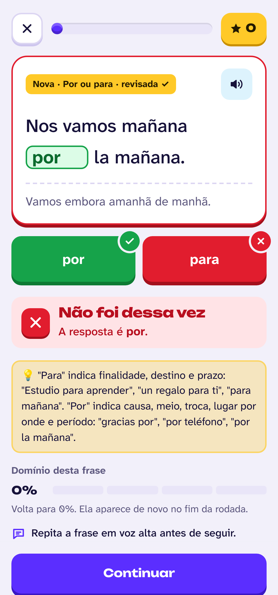</td>
    <td width="33%">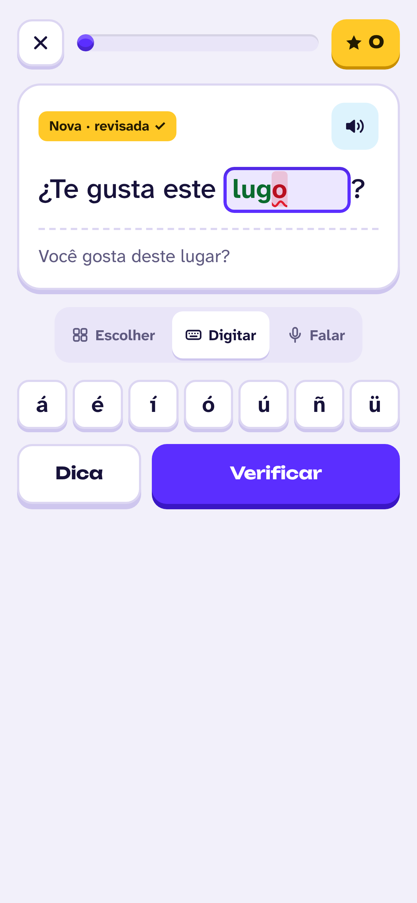</td>
  </tr>
</table>

- **🎚️ Dificuldade** para qualquer trilha: Todas · 🌱 Iniciante · 🌿 Básico · 🌳 Intermediário · 🏔️ Avançado (pela frequência da palavra mais rara da frase).
- **📊 Geral:** coleções Top 100, 500, 1.000, 2.000, 5.000, 10.000 e Avançado; a palavra escondida é a mais rara da frase.
- **🧱 Primeiros passos** (13 temas): cumprimentos, números, cores, dias e meses, família, corpo, roupas, animais, comida, palavras interrogativas, lugares, profissões e adjetivos opostos. A palavra escondida **é** a do tema, e as alternativas vêm do mesmo grupo (outras cores, outros números…).
- **📐 Gramática** (12 temas por idioma, montados por agentes especialistas em ensino de cada língua). A palavra escondida é o próprio ponto gramatical, e cada tema tem uma **dica** que aparece quando você erra:

  | Idioma | Temas |
  |---|---|
  | 🇪🇸 Espanhol | artigos, al/del, **ser ou estar**, hay ou está, muy ou mucho, possessivos, demonstrativos, gusta/gustan, **por ou para**, reflexivos, pretérito (fue/era), subjuntivo |
  | 🇫🇷 Francês | artigos, être/avoir, negação, possessivos, demonstrativos, à/en/au + lugares, partitivo, auxiliar do passé composé, imparfait, le/lui/leur, y/en, qui/que |
  | 🇩🇪 Alemão | sein/haben, ein/eine, nicht/kein, possessivos, modais, preposição + caso, in/an/auf (dativo/acusativo), mich/mir, Perfekt com haben ou sein, weil/dass/wenn/ob, relativos, terminação do adjetivo |
  | 🇮🇹 Italiano | artigos (il/lo…), artigo indefinido, essere/avere, possessivos, preposição + artigo, a/in, molto/troppo, reflexivos, auxiliar do passato prossimo, futuro, pronomes |
  | 🇬🇧 Inglês | a/an/the, verbo to be, there is/are, -s do presente, do/does/did, his/her, in/on/at, some/any, passado irregular, particípio, comparativos, make/do |

- **☀️ Dia a dia** (mercado, restaurante, transporte, casa, saúde, clima, rotina, lazer, sentimentos), **✈️ Viagem** (aeroporto, hotel, direções, turismo), **💼 Profissional** (escritório, e-mail e telefone, carreira, negócios, tecnologia) e **🎓 Acadêmico** (escola, ciência, história, natureza, arte).

## 🖼️ Telas

<table>
  <tr>
    <td width="25%">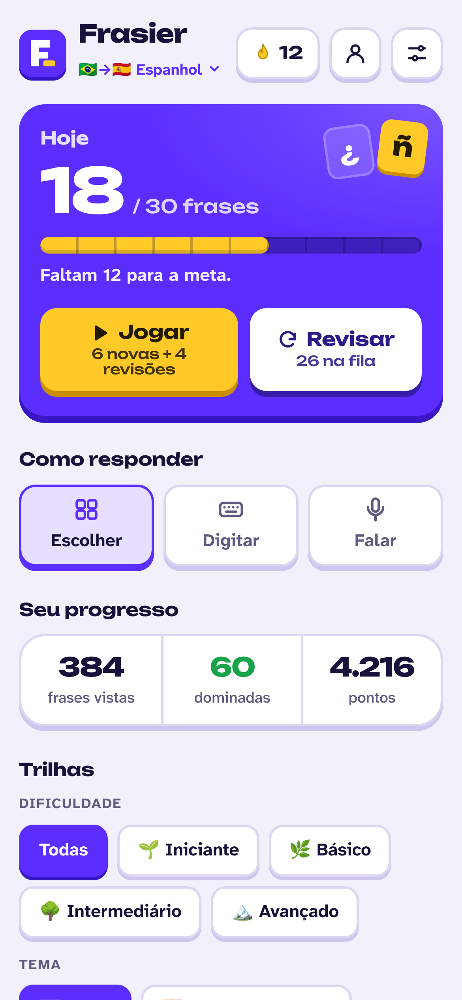</td>
    <td width="25%">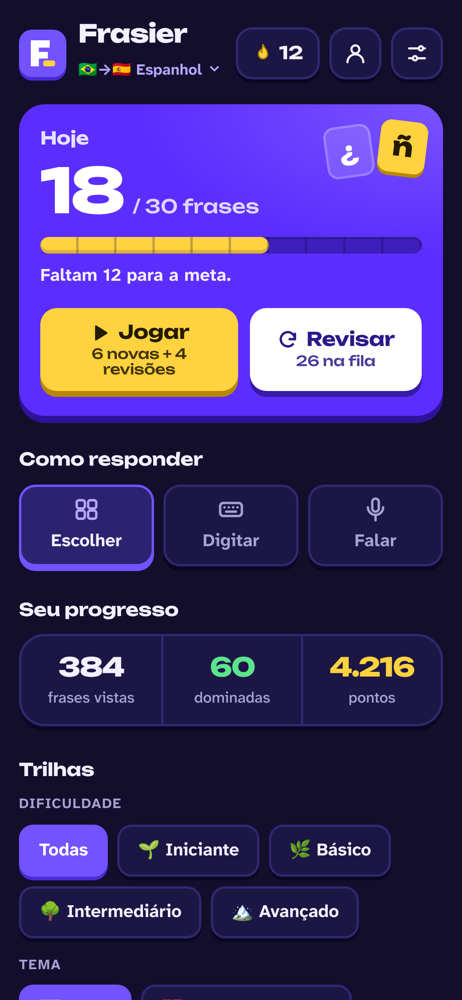</td>
    <td width="25%">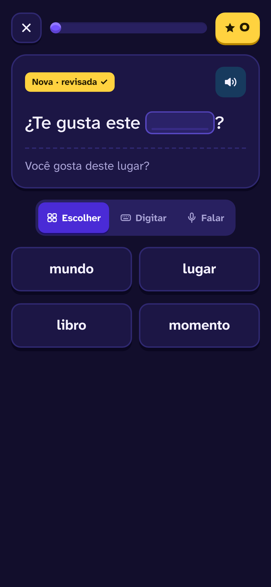</td>
    <td width="25%">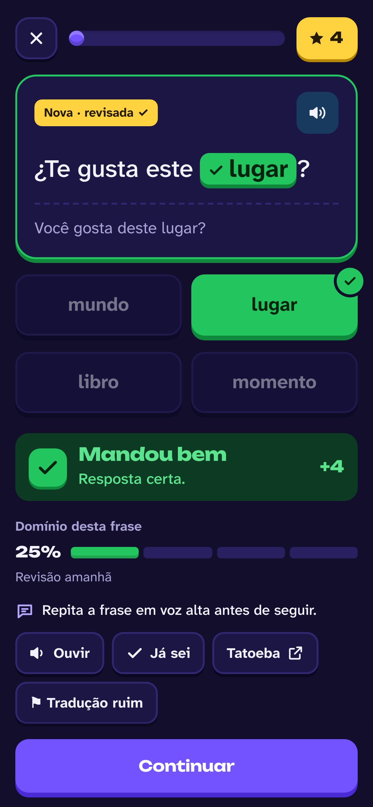</td>
  </tr>
  <tr>
    <td align="center">Início (claro)</td>
    <td align="center">Início (escuro)</td>
    <td align="center">Múltipla escolha</td>
    <td align="center">Acerto e domínio</td>
  </tr>
  <tr>
    <td width="25%">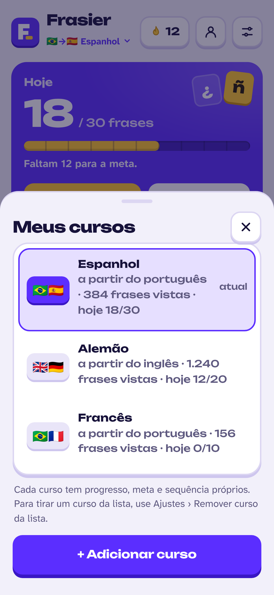</td>
    <td width="25%">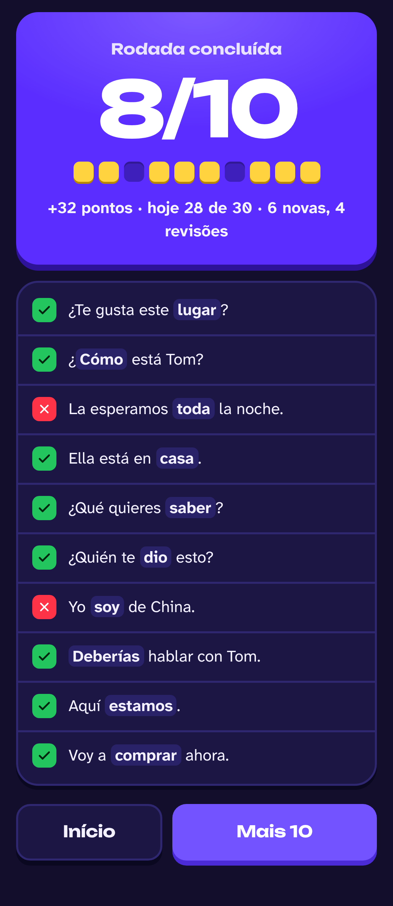</td>
    <td width="25%"></td>
    <td width="25%"></td>
  </tr>
  <tr>
    <td align="center">Meus cursos</td>
    <td align="center">Resumo da rodada</td>
    <td align="center">Trilhas</td>
    <td align="center">Digitar</td>
  </tr>
</table>

## 🎨 Identidade visual

O visual se chama **“Fliperama de frases”**: botões grossos com sombra sólida, como teclas de fliperama, peças de letras (¿ ñ ß ü) como decoração, cantos arredondados e uma pequena animação de “pulo” a cada resposta. O violeta dá personalidade, o amarelo chama para a ação, e verde e vermelho só aparecem para acerto e erro.

<picture>
  <source media="(prefers-color-scheme: dark)" srcset="docs/readme/palette-dark.png">
  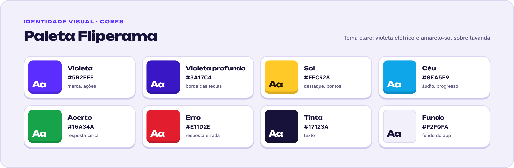
</picture>

<picture>
  <source media="(prefers-color-scheme: dark)" srcset="docs/readme/type-dark.png">
  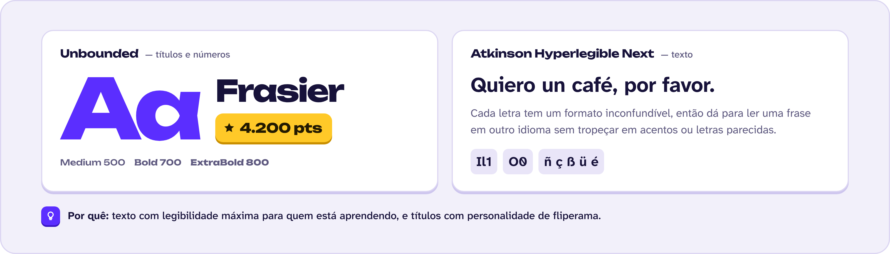
</picture>

<picture>
  <source media="(prefers-color-scheme: dark)" srcset="docs/readme/components-dark.png">
  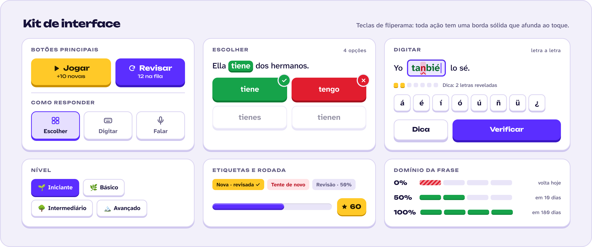
</picture>

## 🛠️ Como funciona por dentro

- **Um arquivo só:** `index.html` com HTML, CSS e JavaScript puro — sem framework e sem etapa de build. `sw.js` é o service worker (offline e atualização) e `manifest.webmanifest` torna o app instalável.
- **Dados** em `data/<origem>-<alvo>/`: blocos `c0.json`, `c1.json`… com 2.000 frases cada (`[frase, tradução, início da lacuna, tamanho, id Tatoeba, id Tatoeba]`), `index.json` (níveis, frases escondidas, até onde foi revisado), `words.json`, `tracks.json` (trilhas temáticas) e `tracks2.json` (Primeiros passos e Gramática, com a posição da lacuna e as alternativas de cada frase).
- **Pipeline das frases** em `tools/`:
  - `build_courses.py` — baixa os exports do Tatoeba, pontua a qualidade (falante nativo, áudio, tags e avaliações negativas da comunidade, proporção de tamanho), ordena pela frequência da palavra e gera os cursos. Roda num workflow do GitHub Actions disparado por `tools/rebuild.txt`.
  - `apply_reviews.py` — aplica as revisões de `tools/reviews/<par>.json` (traduções corrigidas e frases removidas, guardadas pelo id do Tatoeba).
  - `build_tracks.py` — gera as trilhas a partir das regras de `tools/tracks/<idioma>.json` (um regex por tema com a palavra a esconder e as alternativas).
- **Atividades de estudo** em `ext/` (`core.js` com a API comum + um arquivo por atividade: `m-plan.js`, `m-sentence.js`, `m-talk.js`, `m-journal.js`, `m-read.js`; contrato em `ext/CONTRACT.md`).
- **Contas e sincronização:** Firebase Authentication (e-mail e senha) e Firestore, com regras que só deixam cada usuário ler e escrever os próprios dados.

**Rodar localmente:** sirva a pasta com qualquer servidor estático, por exemplo `python3 -m http.server`, e abra `http://localhost:8000`.

## 🙏 Créditos

- Frases e traduções: [Tatoeba.org](https://tatoeba.org), licença [CC BY 2.0 FR](https://creativecommons.org/licenses/by/2.0/fr/). Cada frase tem um link para a original.
- Fontes: [Unbounded](https://fonts.google.com/specimen/Unbounded) e [Atkinson Hyperlegible Next](https://fonts.google.com/specimen/Atkinson+Hyperlegible+Next) (SIL Open Font License).
- Inspirado no [Clozemaster](https://www.clozemaster.com).
- Feito por **Lucas Ayub**, com a ajuda do Claude (Anthropic).
